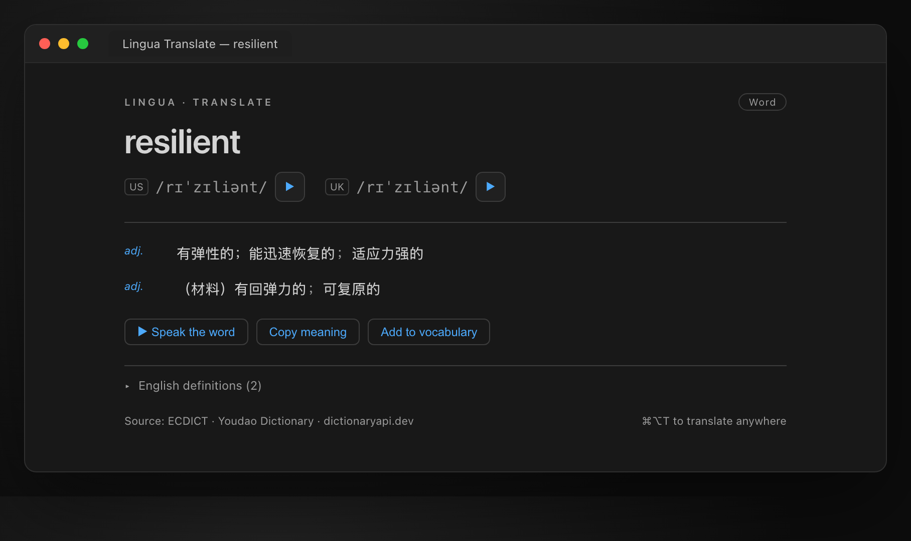
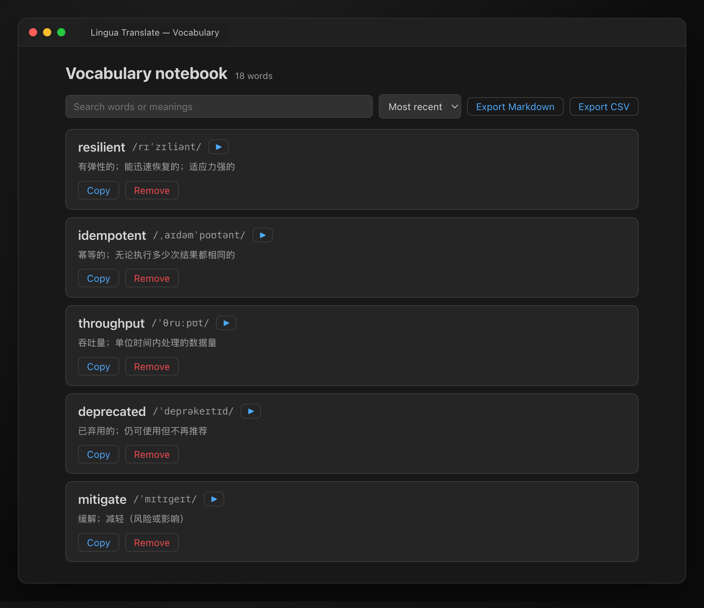
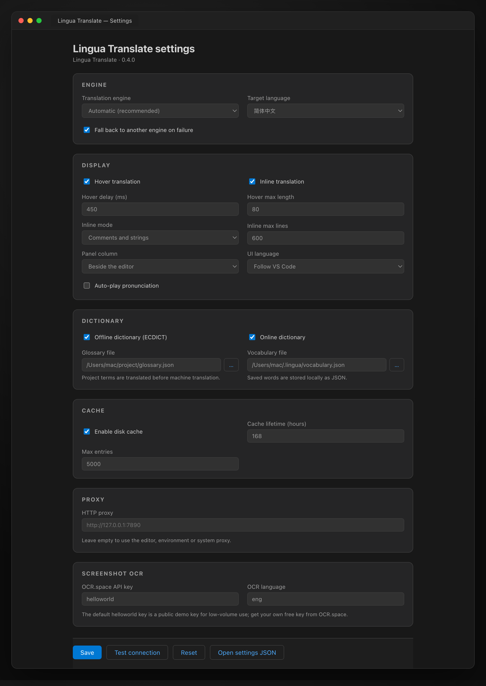

# Lingua Translate

English | [简体中文](README.zh-CN.md)

Translate the selection or hover a word — a universal extension for VS Code-based IDEs. Works with **VS Code / Cursor / Trae CN / Windsurf** and other VS Code derivatives.

> A reading companion for source code: select an identifier, a comment or a whole sentence and instantly get phonetics, definitions, pronunciation and translation. You can also hover a word for a lightweight definition, or show inline translations right after comments.

## Features

- **Translate selection**: `⌘⌥T` / `Ctrl+Alt+T` opens the side translation panel with phonetics (US/UK), part of speech, multiple senses, English definitions and examples, and pronunciation.
- **Translate on hover**: hover a word or identifier to see phonetics, definitions and quick actions (toggleable, adjustable delay).
- **Inline translation**: appends an InlayHint like `⟶ translation` after comments or strings — handy for skimming English comments.
- **Identifier splitting**: `captcha_id`, `getUserInfo` and `api.token` are split into meaningful words, each explained, plus a machine translation of the whole name.
- **Bidirectional EN ↔ ZH**: English selections are translated to Chinese; Chinese selections are translated back to English with phonetics added.
- **Multiple engines + automatic fallback**: Google, MyMemory and Youdao free chains work out of the box; Bing and LibreTranslate are optional depending on your network; DeepL, Azure, Baidu, OpenAI, Claude and Gemini are enabled once configured with a key.
- **Offline dictionary**: bundled trimmed [ECDICT](https://github.com/skywind3000/ECDICT) (about 108k entries including common inflections, roughly 3.2 MB gzipped), so phonetics and definitions still work offline.
- **Disk cache**: translation results are stored in `globalStorage` with TTL and LRU eviction to cut duplicate requests.
- **Glossary / vocabulary notebook**: project glossary (settings object or `.lingua/glossary.json`) and one-click word saving.
- **Pronunciation**: Youdao / Baidu TTS. Audio is downloaded by the extension host and handed to the webview, bypassing CSP restrictions.
- **Settings UI**: graphical configuration for engines, languages, hover, inline translation, cache, proxy and per-engine API keys — with localized labels, range validation, file pickers and a connection test.
- **Translation history**: the last 30 successful translations are saved locally and can be reopened from the quick menu.
- **Clipboard & quick menu**: translate clipboard text directly, or open a status-bar quick menu for every action.
- **Vocabulary notebook**: search, sort, pronounce, copy and delete entries, and export the whole notebook to Markdown or CSV.
- **Resilient panel**: loading skeletons, friendly network errors, and inline Retry / Settings actions when a request fails.
- **Multilingual UI**: follows the IDE language; Simplified Chinese / English.
- **Screenshot OCR**: `Lingua: OCR screenshot and translate` captures part of the screen (macOS) or opens an image, recognizes the text with OCR.space, then reuses the normal dictionary / translation pipeline.
- **Batch translation**: translate a whole `.md` / `.txt` file or an entire folder. Fenced code blocks are preserved and output is written next to the source as `name.<target>.md` — originals are never overwritten.
- Works in untrusted and virtual workspaces.

## Screenshots

| Translation panel | Vocabulary notebook |
| --- | --- |
|  |  |



> These images are previews of the extension UI in the default dark theme.

## Installation

### Install from VSIX

```bash
code --install-extension release/lingua-translate-0.4.0.vsix --force
cursor --install-extension release/lingua-translate-0.4.0.vsix --force
```

Trae CN:

```bash
"/Applications/Trae CN.app/Contents/Resources/app/bin/trae-cn" --install-extension release/lingua-translate-0.4.0.vsix --force
```

Reload the window after installing (`Cmd+Shift+P` → `Developer: Reload Window`).

## Usage

| Action | macOS | Windows / Linux |
| --- | --- | --- |
| Translate selection | `⌘⌥T` | `Ctrl+Alt+T` |
| Translate word under cursor | `⌘⌥H` | `Ctrl+Alt+H` |
| Pronounce selection | `⌘⌥P` | `Ctrl+Alt+P` |
| Hover translation | Hover the mouse | Hover the mouse |
| Add to vocabulary | Context menu / Code Action | Context menu / Code Action |
| Translate clipboard | Command palette | Command palette |
| OCR screenshot | Command palette / Quick menu | Command palette / Quick menu |
| Translate whole file / folder | Command palette / Quick menu | Command palette / Quick menu |
| Recent translations | Status bar / Quick menu | Status bar / Quick menu |

All commands are also available in the command palette under `Lingua: ...`. Clicking the `Lingua` status-bar item opens the quick menu with translate, vocabulary, history, settings and toggle actions.

## Translation engines

| Engine | Cost | Configuration | Notes |
| --- | --- | --- | --- |
| `google` | Free | None | `translate.googleapis.com`; falls back to an alternate endpoint on failure |
| `bing` | Free | None | Scrapes the `www.bing.com/translator` page token, then calls `ttranslatev3`; the public endpoint has bot detection and may return 401 on some networks |
| `mymemory` | Free | None | Anonymous quota applies; a good last resort |
| `libretranslate` | Free / self-hosted | `libretranslate.url` (optional API key) | Public instances require a paid key; self-host one and set the URL |
| `youdao` | Free | None | Web dictionary endpoint with good word-level quality |
| `deepl` | Paid | `deepl.apiKey` | Free keys usually end with `:fx`; automatically switches to api-free |
| `azure` | Paid | `azure.apiKey` / `azure.region` | Microsoft Translator v3 |
| `baidu` | Paid | `baidu.appId` / `baidu.appKey` | Baidu Translate open platform |
| `openai` | Paid | `openai.apiKey` | Custom baseUrl / model supported |
| `claude` | Paid | `claude.apiKey` | Anthropic Messages API |
| `gemini` | Paid | `gemini.apiKey` | Google Generative Language API |

`linguaTranslate.engine = auto` (the default) tries **Google → MyMemory → LibreTranslate → Youdao → Bing** in order (LibreTranslate is skipped when `libretranslate.url` is empty). When a paid engine is selected and `fallback` is on, failures fall back to the free chain automatically.

## Common settings

Configure them in the settings UI (command `Lingua: Open Lingua settings`) or in `settings.json`:

```jsonc
{
  "linguaTranslate.targetLanguage": "zh-CN",
  "linguaTranslate.engine": "auto",
  "linguaTranslate.fallback": true,

  "linguaTranslate.hover.enabled": true,
  "linguaTranslate.hover.delay": 300,
  "linguaTranslate.hover.maxLength": 40,

  "linguaTranslate.inline.enabled": false,
  "linguaTranslate.inline.mode": "comment", // comment | string | both

  "linguaTranslate.panelColumn": "beside", // beside | active
  "linguaTranslate.autoPlay": false,
  "linguaTranslate.uiLanguage": "auto", // auto | zh-CN | en

  "linguaTranslate.dictionary.offline": true,
  "linguaTranslate.dictionary.online": true,

  "linguaTranslate.cache.enabled": true,
  "linguaTranslate.cache.ttlHours": 168,
  "linguaTranslate.cache.maxEntries": 5000,

  "linguaTranslate.proxy": "", // e.g. http://127.0.0.1:7890
  "linguaTranslate.ocr.apiKey": "helloworld",
  "linguaTranslate.ocr.language": "eng",

  "linguaTranslate.deepl.apiKey": "",
  "linguaTranslate.openai.apiKey": ""
}
```

### Proxy

Proxy resolution order:

1. `linguaTranslate.proxy`
2. Editor `http.proxy`
3. Environment variables `HTTPS_PROXY` / `HTTP_PROXY` / `ALL_PROXY`
4. macOS system proxy (`scutil --proxy`)

### Screenshot OCR

`Lingua: OCR screenshot and translate` (`linguaTranslate.ocrScreenshot`):

1. On macOS, `screencapture -i` lets you drag a region; on other platforms an image picker opens.
2. The image is sent to [OCR.space](https://ocr.space/ocrapi) and recognized as plain text.
3. The text goes through the same dictionary / translation pipeline as a normal selection.

The default `helloworld` key is a public demo key for low-volume use. Register a free key and set `linguaTranslate.ocr.apiKey`; choose the source script with `linguaTranslate.ocr.language` (`eng`, `chs`, `jpn`, `kor`, `deu`, `fra`, …). OCR requests go direct (the proxy setting is used for translation engines only).

### Batch translation

- `Lingua: Translate whole file (.md / .txt)` — pick one or more files.
- `Lingua: Translate a folder (.md / .txt)` — recursively translates every Markdown / text file.

Long documents are split into paragraph-aware chunks (about 1200 characters) and sent sequentially. Fenced code blocks are left untouched. Results are written next to each source file as `<name>.<target>.md` / `.txt` (for example `guide.zh-CN.md`), so the originals are never overwritten; files already ending in the target suffix are skipped on folder runs.

### Glossary

Two options:

1. The `linguaTranslate.glossary` setting:

```json
{
  "linguaTranslate.glossary": {
    "api": "接口",
    "token": "令牌",
    "captcha": "验证码"
  }
}
```

2. A workspace file `.lingua/glossary.json`, with `linguaTranslate.glossaryPath` set to `.lingua/glossary.json`:

```json
{
  "api": "接口",
  "token": "令牌"
}
```

Exact glossary hits take precedence over machine translation; a multi-word phrase is adopted as a whole only when every word matches.

### Vocabulary notebook

`Lingua: Add selection to vocabulary` stores the word, phonetics and definitions in:

- By default: `globalStorage/vocabulary.json` of the extension
- Or the JSON file specified by `linguaTranslate.vocabularyPath` (relative paths resolve from the workspace root)

`Lingua: Open vocabulary notebook` lets you search, sort, pronounce, copy and delete entries, and export the notebook to Markdown or CSV. `Lingua: Show recent translations` reopens one of the last 30 successful lookups.

## Offline dictionary

`data/ecdict.json.gz` is generated by `scripts/build-ecdict.mjs` from the full ECDICT CSV. Filtering rules:

- ASCII words only (letters, `'`, `-`), length 1–24;
- keep Collins / Oxford flagged words, tagged words, and words in the top 50,000 by BNC / frequency rank;
- additionally keep inflected forms of those core words (plural, past tense, present participle, etc.) so forms such as `deprecated` or `migrating` in code comments resolve offline;
- at most 120,000 entries, definitions truncated to 220 characters.

Current output: **108,123 entries, 6.75 MB uncompressed, 3.16 MB gzipped**.

Regenerate:

```bash
# Download ECDICT first (about 63 MB)
curl -L -o /tmp/ecdict.csv https://raw.githubusercontent.com/skywind3000/ECDICT/master/ecdict.csv
npm run build:ecdict -- --input /tmp/ecdict.csv --output data/ecdict.json.gz
```

## Privacy

- Selected text is sent only to the **translation / dictionary services you configure** (Google, Bing, MyMemory, LibreTranslate, Youdao, Baidu, DeepL, Azure, OpenAI, Anthropic, Google Gemini).
- The glossary, vocabulary notebook and translation cache stay on your machine.
- The extension collects no telemetry and never uploads your code files.

## Troubleshooting

- **Nothing happens on hover** — check `linguaTranslate.hover.enabled`; hover ignores identifiers longer than `hover.maxLength`.
- **Requests fail behind a proxy** — set `linguaTranslate.proxy` (for example `http://127.0.0.1:7890`) or rely on the editor / environment / system proxy.
- **Bing returns 401** — the public endpoint uses bot detection; `auto` mode skips it in favor of Google / MyMemory / Youdao.
- **A paid engine fails** — verify the key and region; with `fallback` enabled the extension retries the free chain automatically.
- **Stale results** — run `Lingua: Clear translation cache`.
- **Settings not applied** — the settings webview saves to global settings; a reload is rarely needed, but `Developer: Reload Window` forces a clean re-read.

## Tech stack

- TypeScript 5 (strict) compiled by esbuild into a single CommonJS bundle.
- VS Code Extension API only — no runtime dependencies beyond Node's `https`, `zlib` and the bundled dictionary.
- vitest for unit tests; GitHub Actions for CI and VSIX release packaging.
- Webviews are dependency-free HTML/CSS/JS with a nonce-based CSP and theme variables, so they inherit the host IDE theme.

## Development

```bash
npm install
npm run build              # esbuild → dist/extension.js
npm run typecheck          # tsc --noEmit
npm run lint               # ESLint (typescript-eslint)
npm test                   # vitest unit tests
npm run test:integration   # extension-host tests (downloads VS Code on first run)
npm run test:integration:local  # same tests using the installed VS Code
npm run package            # build the .vsix
```

Debugging: open this repository in VS Code and press `F5` to launch the extension development host.

## Roadmap

- [x] Hover translation / inline translations / multiple engines / disk cache / settings UI
- [x] Glossary / vocabulary notebook / offline dictionary / multiple languages / i18n
- [x] Translation history, clipboard translation, quick menu, vocabulary search & export
- [x] Unit tests and CI
- [ ] Screenshot OCR translation (manually triggered; planned)
- [ ] Batch translation for whole files / directories
- [ ] Lemmatization and more complete ECDICT frequency ranking
- [ ] Integration tests against a VS Code test host

## License

Code: [MIT](LICENSE). The offline dictionary data comes from [ECDICT](https://github.com/skywind3000/ECDICT), also released under MIT; see [NOTICE](NOTICE) for details.
