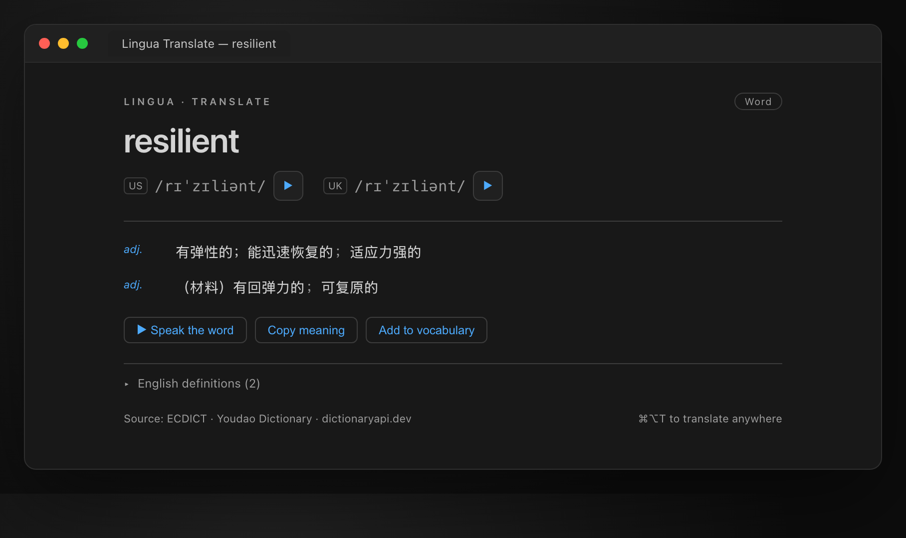
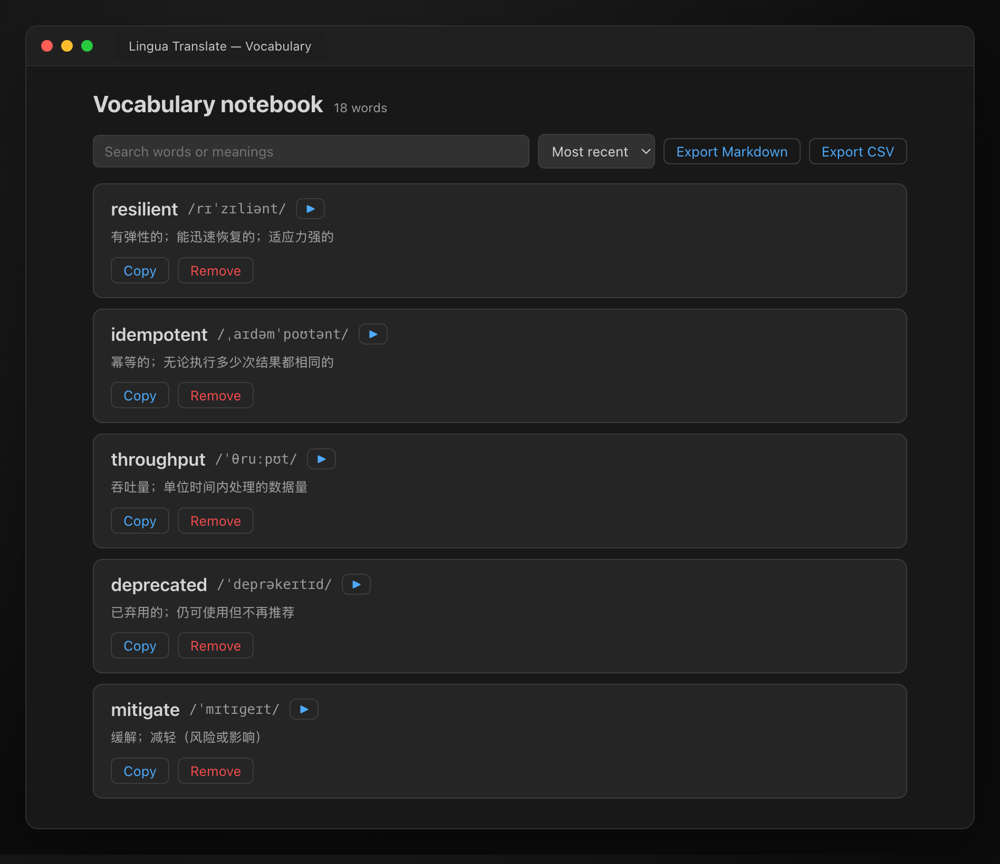
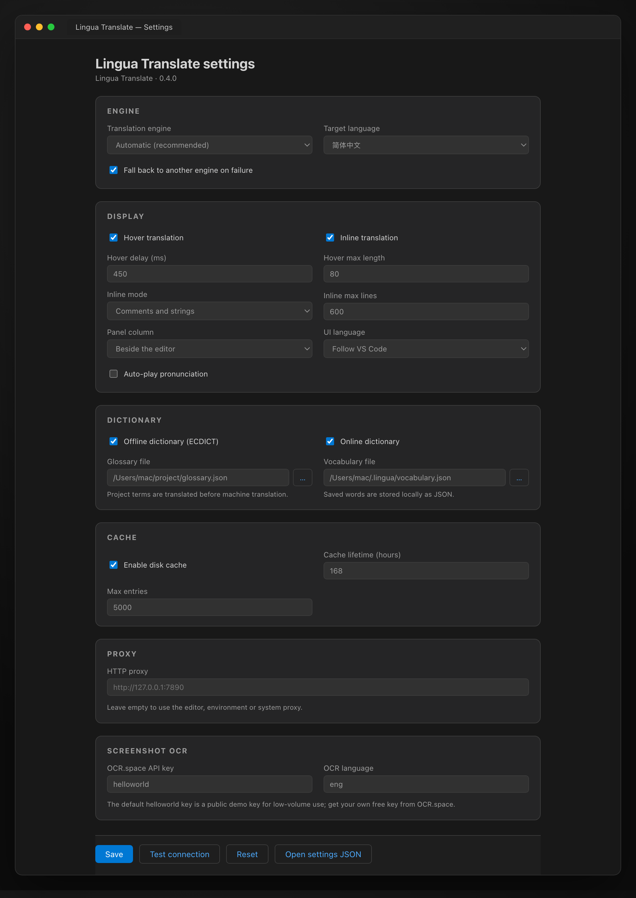

# Lingua Translate

[English](README.md) | 简体中文

选中或悬停即翻译的 VS Code 系通用扩展。兼容 **VS Code / Cursor / Trae CN / Windsurf** 等基于 VS Code 的 IDE。

> 面向中文开发者的代码阅读助手：选中标识符、注释或整句，立刻得到音标、释义、发音和译文；也可以悬停单词查看轻量释义，或让注释后直接出现内联译文。

## 功能

- **选中翻译**：`⌘⌥T` / `Ctrl+Alt+T` 打开侧边翻译面板，展示音标（英/美）、词性、多义项、英文释义与例句、发音。
- **悬停即译**：鼠标停在单词或标识符上，显示音标、中文释义与快捷入口（可开关、可调延迟）。
- **内联译文**：在注释或字符串末尾追加 `⟶ 译文` 的内联提示（InlayHint），适合快速浏览英文注释。
- **标识符拆词**：`captcha_id`、`getUserInfo`、`api.token` 会拆成有意义的单词逐个解释，并给出整词机器翻译。
- **中英双向**：选中英文译成中文；选中中文自动反译成英文，并补充英文音标。
- **多引擎 + 自动降级**：Google、MyMemory、有道免费链路开箱即用；Bing、LibreTranslate 视网络环境可选；DeepL、Azure、百度、OpenAI、Claude、Gemini 配置 Key 后启用。
- **离线词库**：内置 [ECDICT](https://github.com/skywind3000/ECDICT) 裁剪版（约 10.8 万词条，含常用词形变化，gzip 后约 3.2 MB），断网也能查音标与释义。
- **磁盘缓存**：翻译结果写入 `globalStorage`，带 TTL 与 LRU 淘汰，减少重复请求。
- **术语表 / 生词本**：支持项目术语表（设置对象或 `.lingua/glossary.json`）与一键收藏生词。
- **发音**：有道 / 百度 TTS，音频由扩展主进程下载后交给 Webview 播放，不受 CSP 限制。
- **设置页**：图形化配置引擎、语言、悬停、内联、缓存、代理与各引擎 API Key，带本地化标签、数值范围校验、文件选择与连接测试。
- **翻译历史**：自动保存最近 30 条成功翻译，可从快捷菜单重新打开。
- **剪贴板与快捷菜单**：可直接翻译剪贴板内容；点击状态栏 `Lingua` 打开包含全部操作的快捷菜单。
- **生词本**：支持搜索、排序、发音、复制、删除，并可导出为 Markdown 或 CSV。
- **可靠面板**：加载骨架屏、友好的网络错误提示，失败时可直接重试或打开设置。
- **多语言 UI**：跟随 IDE 语言，支持简体中文 / English。
- **识屏翻译**：`Lingua: 识屏翻译（截图 OCR）` 在 macOS 上框选屏幕区域（其他平台选择图片），用 OCR.space 识别文字后复用词典 / 翻译链路。
- **批量翻译**：翻译整个 `.md` / `.txt` 文件或整个目录；保留围栏代码块，结果写到源文件旁的 `名称.<目标语言>.md`，绝不覆盖原文件。
- 兼容不受信任工作区与虚拟工作区。

## 界面预览

| 翻译面板 | 生词本 |
| --- | --- |
|  |  |



> 以上为扩展在默认深色主题下的界面预览。

## 安装

### 从 VSIX 安装

```bash
code --install-extension lingua-translate-0.4.0.vsix --force
cursor --install-extension lingua-translate-0.4.0.vsix --force
```

Trae CN：

```bash
"/Applications/Trae CN.app/Contents/Resources/app/bin/trae-cn" --install-extension lingua-translate-0.4.0.vsix --force
```

安装后重载窗口（`Cmd+Shift+P` → `Developer: Reload Window`）。

## 使用

| 操作 | macOS | Windows / Linux |
| --- | --- | --- |
| 翻译选中文本 | `⌘⌥T` | `Ctrl+Alt+T` |
| 翻译光标处单词 | `⌘⌥H` | `Ctrl+Alt+H` |
| 朗读选中文本 | `⌘⌥P` | `Ctrl+Alt+P` |
| 悬停翻译 | 鼠标悬停 | 鼠标悬停 |
| 加入生词本 | 右键菜单 / Code Action | 右键菜单 / Code Action |
| 翻译剪贴板 | 命令面板 | 命令面板 |
| 识屏翻译（OCR） | 命令面板 / 快捷菜单 | 命令面板 / 快捷菜单 |
| 翻译整个文件 / 目录 | 命令面板 / 快捷菜单 | 命令面板 / 快捷菜单 |
| 最近翻译 | 状态栏 / 快捷菜单 | 状态栏 / 快捷菜单 |

也可以在命令面板执行 `Lingua: ...` 开头的命令。点击状态栏的 `Lingua` 项会打开快捷菜单（翻译、生词本、历史、设置与开关）。

## 翻译引擎

| 引擎 | 费用 | 需要配置 | 说明 |
| --- | --- | --- | --- |
| `google` | 免费 | 无 | `translate.googleapis.com`，失败自动换备用端点 |
| `bing` | 免费 | 无 | 抓取 `www.bing.com/translator` 页面令牌后请求 `ttranslatev3`；公开接口有机器人检测，部分网络会返回 401 |
| `mymemory` | 免费 | 无 | 有匿名额度限制，适合兜底 |
| `libretranslate` | 免费/自建 | `libretranslate.url`（可选 API Key） | 公共实例需付费 Key，建议自建实例后填写地址 |
| `youdao` | 免费 | 无 | 网页词典接口，单词质量较好 |
| `deepl` | 付费 | `deepl.apiKey` | 免费版 Key 通常以 `:fx` 结尾，自动切换 api-free |
| `azure` | 付费 | `azure.apiKey` / `azure.region` | 微软翻译 v3 |
| `baidu` | 付费 | `baidu.appId` / `baidu.appKey` | 百度翻译开放平台 |
| `openai` | 付费 | `openai.apiKey` | 支持自定义 baseUrl / model |
| `claude` | 付费 | `claude.apiKey` | Anthropic Messages API |
| `gemini` | 付费 | `gemini.apiKey` | Google Generative Language API |

`linguaTranslate.engine = auto`（默认）会按 **Google → MyMemory → LibreTranslate → 有道 → Bing** 顺序尝试（未填写 `libretranslate.url` 时自动跳过）；选择付费引擎且开启 `fallback` 时，失败会自动回到免费链路。

## 常用设置

在设置页（命令 `Lingua: 打开 Lingua 设置`）或 `settings.json` 中配置：

```jsonc
{
  "linguaTranslate.targetLanguage": "zh-CN",
  "linguaTranslate.engine": "auto",
  "linguaTranslate.fallback": true,

  "linguaTranslate.hover.enabled": true,
  "linguaTranslate.hover.delay": 300,
  "linguaTranslate.hover.maxLength": 40,

  "linguaTranslate.inline.enabled": false,
  "linguaTranslate.inline.mode": "comment", // comment | string | both

  "linguaTranslate.panelColumn": "beside", // beside | active
  "linguaTranslate.autoPlay": false,
  "linguaTranslate.uiLanguage": "auto", // auto | zh-CN | en

  "linguaTranslate.dictionary.offline": true,
  "linguaTranslate.dictionary.online": true,

  "linguaTranslate.cache.enabled": true,
  "linguaTranslate.cache.ttlHours": 168,
  "linguaTranslate.cache.maxEntries": 5000,

  "linguaTranslate.proxy": "", // 例如 http://127.0.0.1:7890
  "linguaTranslate.ocr.apiKey": "helloworld",
  "linguaTranslate.ocr.language": "eng",

  "linguaTranslate.deepl.apiKey": "",
  "linguaTranslate.openai.apiKey": ""
}
```

### 代理

代理优先级：

1. `linguaTranslate.proxy`
2. 编辑器 `http.proxy`
3. 环境变量 `HTTPS_PROXY` / `HTTP_PROXY` / `ALL_PROXY`
4. macOS 系统代理（`scutil --proxy`）

### 识屏翻译

`Lingua: 识屏翻译（截图 OCR）`（命令 `linguaTranslate.ocrScreenshot`）：

1. macOS 下调用 `screencapture -i` 框选区域；其他平台弹出图片选择器。
2. 图片发送到 [OCR.space](https://ocr.space/ocrapi) 识别为纯文本。
3. 识别结果走与普通选中文本相同的词典 / 翻译链路。

默认 `helloworld` 是公共测试 Key，仅适合低频使用；建议注册免费 Key 并填入 `linguaTranslate.ocr.apiKey`。用 `linguaTranslate.ocr.language` 指定源语言文字（`eng`、`chs`、`jpn`、`kor`、`deu`、`fra` 等）。OCR 请求为直连，代理设置只作用于翻译引擎。

### 批量翻译

- `Lingua: 翻译整个文件（.md / .txt）`：选择一个或多个文件。
- `Lingua: 翻译整个目录（.md / .txt）`：递归翻译目录下所有 Markdown / 文本文件。

长文档按段落切成约 1200 字符的块并顺序发送；围栏代码块保持原样。结果写到源文件旁，命名为 `<原名>.<目标语言>.md` / `.txt`（如 `guide.zh-CN.md`），不覆盖原文；目录模式下会跳过已带目标语言后缀的文件。

### 术语表

有两种方式：

1. 设置项 `linguaTranslate.glossary`：

```json
{
  "linguaTranslate.glossary": {
    "api": "接口",
    "token": "令牌",
    "captcha": "验证码"
  }
}
```

2. 工作区文件 `.lingua/glossary.json`，并把 `linguaTranslate.glossaryPath` 设为 `.lingua/glossary.json`：

```json
{
  "api": "接口",
  "token": "令牌"
}
```

术语表精确命中时优先于机器翻译；多词短语只有全部词都命中时才整体采用。

### 生词本

`Lingua: 加入生词本` 会把单词、音标与释义写入：

- 默认：扩展 `globalStorage/vocabulary.json`
- 或 `linguaTranslate.vocabularyPath` 指定的 JSON 文件（相对路径基于工作区根目录）

`Lingua: 打开生词本` 可搜索、排序、发音、复制和删除条目，并导出为 Markdown 或 CSV；`Lingua: 查看最近翻译` 可重新打开最近 30 条成功翻译。

## 离线词库

`data/ecdict.json.gz` 由 `scripts/build-ecdict.mjs` 从 ECDICT 全量 CSV 生成，过滤规则：

- 仅保留 ASCII 单词（字母、`'`、`-`），长度 1–24；
- 保留 Collins / Oxford 标记词、带标签词，以及 BNC / 词频排名前 50,000 的词；
- 额外保留这些核心词的词形变化（复数、过去式、现在分词等），保证 `deprecated`、`migrating` 这类代码注释里的变形也能离线查询；
- 最多 120,000 条，释义截断到 220 字符。

当前产物：**108,123 条，未压缩 6.75 MB，gzip 后 3.16 MB**。

重新生成：

```bash
# 先下载 ECDICT（约 63 MB）
curl -L -o /tmp/ecdict.csv https://raw.githubusercontent.com/skywind3000/ECDICT/master/ecdict.csv
npm run build:ecdict -- --input /tmp/ecdict.csv --output data/ecdict.json.gz
```

## 隐私

- 选中文本只发送到**你配置的翻译/词典服务**（Google、Bing、MyMemory、LibreTranslate、有道、百度、DeepL、Azure、OpenAI、Anthropic、Google Gemini）。
- 术语表、生词本、翻译缓存均保存在本机。
- 扩展不收集遥测，不上传代码文件。

## 常见问题

- **悬停没有反应**：检查 `linguaTranslate.hover.enabled`；超过 `hover.maxLength` 的标识符会被忽略。
- **代理环境下请求失败**：设置 `linguaTranslate.proxy`（例如 `http://127.0.0.1:7890`），或使用编辑器 / 环境变量 / 系统代理。
- **Bing 返回 401**：公开接口带机器人检测；`auto` 模式会优先走 Google / MyMemory / 有道。
- **付费引擎失败**：确认 Key 与区域；开启 `fallback` 后会自动回到免费链路。
- **结果陈旧**：执行 `Lingua: 清除翻译缓存`。
- **设置未生效**：设置页写入全局设置，通常无需重载；必要时执行 `Developer: Reload Window` 强制重新读取。

## 技术栈

- TypeScript 5（strict），由 esbuild 打包为单个 CommonJS 文件。
- 运行时仅依赖 VS Code Extension API 与 Node 内置模块（`https`、`zlib`），离线词库随扩展打包。
- vitest 单元测试；GitHub Actions 负责 CI 与 VSIX 发布打包。
- Webview 为无依赖的 HTML/CSS/JS，使用 nonce CSP 与主题变量，自动继承宿主 IDE 主题。

## 开发

```bash
npm install
npm run build              # esbuild → dist/extension.js
npm run typecheck          # tsc --noEmit
npm run lint               # ESLint（typescript-eslint）
npm test                   # vitest 单元测试
npm run test:integration   # 扩展宿主集成测试（首次会下载 VS Code）
npm run test:integration:local  # 用本机已安装的 VS Code 运行同样的测试
npm run package            # 生成 .vsix
```

调试：用 VS Code 打开本仓库，按 `F5` 启动扩展开发宿主。

## 路线图

- [x] 悬停翻译 / 内联译文 / 多引擎 / 磁盘缓存 / 设置页
- [x] 术语表 / 生词本 / 离线词库 / 多语种 / i18n
- [x] 翻译历史、剪贴板翻译、快捷菜单、生词本搜索与导出
- [x] 单元测试与 CI
- [ ] 截图 OCR 翻译（需用户手动触发，计划中）
- [ ] 整文件 / 整目录批量翻译
- [ ] 词形还原与更完整的 ECDICT 词频排序
- [ ] 基于 VS Code 测试宿主的集成测试

## 许可证

代码：[MIT](LICENSE)。离线词库数据来自 [ECDICT](https://github.com/skywind3000/ECDICT)，同样以 MIT 许可发布，详见 [NOTICE](NOTICE)。
